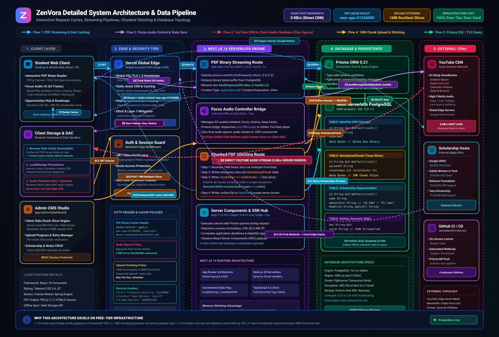

# ⚡ Zenvora

> **Learn tech the simplest way possible.**  
> Curated roadmaps, hands-on masterclasses, and practical engineering resources for students and self-taught developers. Stop getting lost in tutorial hell.

---

## 🌟 What is Zenvora?

Self-taught tech education is cluttered with fragmented playlists and outdated tutorials. **Zenvora** organizes the developer journey into structured tracks with high-signal content:

- 🧭 **Interactive 3D Domain Explorer:** Intuitive 3D perspective carousel with inertia physics and touch-drag navigation.
- 🎯 **Curated Engineering Tracks:** Structured roadmaps for **DSA**, **Web Dev**, **Backend Engineering**, **Full Stack**, **CS Fundamentals**, **Machine Learning**, **Generative AI**, **Competitive Programming**, and **System Design**.
- 📑 **Interactive PDF Notes Reader:** In-browser PDF reader with fast streaming, text layer annotations, and distraction-free study mode.
- 🎧 **Focus Audio Music Player:** Curated distraction-free study soundscapes (63 tracks, mood pills, sliding animation, 2.5px interactive scrollbar) streamed via YouTube CDN.
- 🎓 **Verified Opportunities & Scholarships:** Financial aid and international opportunities for engineering students with USD/INR conversion.
- 🎬 **Integrated Masterclasses:** Handpicked lecture series and video courses organized into structured chapters.
- 🛠️ **Developer Toolkit & Opportunities:** Essential developer software, campus ambassador programs, and curated student opportunities.

---

## 🏛️ System Architecture



### 🔄 End-to-End Request Pipelines

| Flow | Pathway | Description |
|---|---|---|
| **Flow 1: PDF Notes Streaming & Disk Caching** | `Student UI ➔ Vercel Edge ➔ /api/notes/pdf/[id] ➔ Prisma ORM ➔ Neon PostgreSQL (bytea) ➔ Browser Disk Cache` | Queries the raw binary buffer from PostgreSQL bytea column, attaches `Cache-Control: public, max-age=31536000, immutable`, and caches the PDF on the user's disk for instant zero-network re-reads. |
| **Flow 2 & 3: Zero-Egress Focus Audio Engine** | `Audio UI ➔ MusicContext ➔ LocalStorage Sync ➔ Invisible IFrame ➔ YouTube CDN ➔ Client DAC` | Audio playback is decoupled from the web server. When a student chooses from 63 curated tracks, an IFrame event bridge instructs YouTube's CDN to stream audio directly to the student's hardware audio DAC — resulting in **0 KB/s** server egress. |
| **Flow 4: Chunked PDF Upload & Stitching** | `Admin CMS ➔ Client Chunk Slicer (1MB) ➔ /api/admin/notes/upload ➔ NoteUploadChunk ➔ Buffer.concat() ➔ NoteFile` | Bypasses Vercel's 4.5MB serverless payload limit by slicing large PDF notes into 1MB chunks on the client side. On the final slice, the server stitches the buffers in RAM and saves the complete file to PostgreSQL. |
| **Flow 5: Dynamic Opportunities & Scholarships** | `Student UI ➔ RSC Server Component ➔ Prisma ORM ➔ Neon PostgreSQL ➔ External Portal Linkouts` | Dynamically queries scholarships, formats amounts with real-time USD ($) and INR (₹) conversions, tags deadlines, and provides direct links to Google APAC and Adobe WIT portals. |
| **Flow 6: GitHub CI/CD & Production Edge** | `git push origin main ➔ GitHub Webhooks ➔ Vercel Edge Build ➔ Prisma Schema Sync ➔ Global Edge PoPs` | Continuous deployment pipeline automatically synchronizes database schema, builds optimized static bundles, and distributes edge serverless functions globally. |

### 🔑 Architectural Highlights

1. **Zero-Bandwidth Focus Audio Engine:** All 63 study tracks are streamed via YouTube's global CDN through an invisible IFrame event bridge, requiring **0 MB/s** audio transfer on your web server.
2. **Chunked PDF Uploads with Dynamic Stitching:** Uploads bypass serverless file-size limits by sending slice chunks to `/api/admin/notes/upload`, where `Buffer.concat` merges them before writing to PostgreSQL.
3. **Immutable Caching on PDF Streams:** PDFs are served with `Cache-Control: public, max-age=31536000, immutable`, enabling instant repeat loads straight from the user's browser disk cache.
4. **Neon Serverless PostgreSQL + Prisma ORM:** Houses relational data, scholarships, application settings, and PDF binaries in a single unified schema.
5. **Client-Side Persistence:** Volume levels, track favorites, and recently played songs persist in `localStorage` for zero-latency instant offline state retrieval.

---

## 🛠️ Tech Stack

Built with a modern, high-performance web stack:

| Layer | Technology |
|---|---|
| **Framework** | [Next.js 14](https://nextjs.org/) (App Router, Server & Client Components) |
| **Language** | [TypeScript](https://www.typescriptlang.org/) |
| **Styling** | [Tailwind CSS](https://tailwindcss.com/) with hardware-accelerated 3D transforms |
| **Animations** | [Framer Motion](https://www.framer.com/motion/) & CSS 3D Perspective Engine |
| **Database & ORM** | [Prisma 5.21](https://www.prisma.io/) + [Neon Serverless PostgreSQL](https://neon.tech/) |
| **Authentication** | [NextAuth.js](https://next-auth.js.org/) |
| **Audio Engine** | YouTube IFrame Audio Controller |
| **Icons** | [Lucide React](https://lucide.dev/) |

---

## 🚀 Quick Setup

```bash
# 1. Clone & install dependencies
git clone https://github.com/samiralam321/zenvora-platform.git
cd zenvora-platform
npm install

# 2. Setup environment & database
cp .env.example .env
npm run prisma:push

# 3. Start local development
npm run dev
```

Visit [zenvora-platform.vercel.app](https://zenvora-platform.vercel.app) to explore.

---

## 📄 License

Private & Proprietary. All rights reserved.
